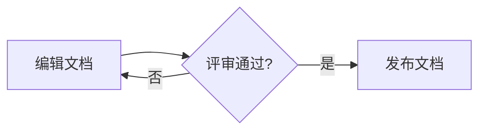
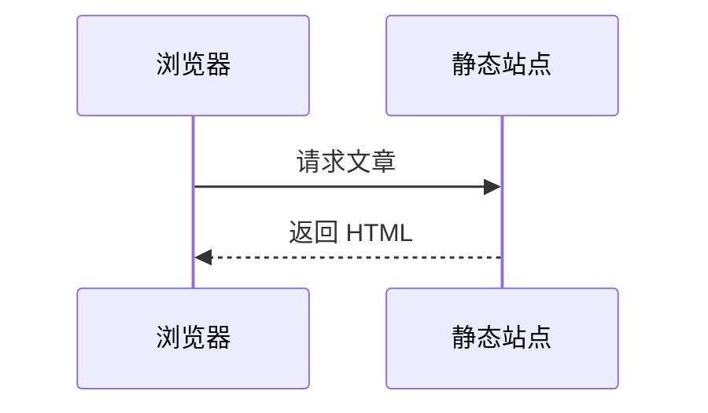

# Markdown 语法指南

Markdown 是用纯文本描述文档结构的标记语言。作者通过符号表达标题、列表、链接和代码，渲染器再将这些文本转换为 HTML 等格式；`.md` 和 `.markdown` 是常见文件后缀。

例如，团队可以用 Markdown 编写发布记录，把变更写成列表、把配置放进代码块，再用链接指向依据。原始文件仍能直接阅读，也适合用 Git 比较修改；表格、脚注、公式等功能能否显示，则取决于目标平台使用的语法规则和插件。

## 一、语法范围与预览

### 1. 基础语法与扩展

Markdown 并不是“在所有工具中完全相同的一套排版功能”。CommonMark 规范明确了常用基础规则，GitHub Flavored Markdown（GFM）在这些规则上增加表格、删除线和任务列表等扩展；GitHub 网站另外提供脚注、警报和图表等能力。

| 范围 | 代表写法 | 使用条件 |
|------|----------|----------|
| CommonMark 基础 | 标题、段落、强调、列表、引用、代码、链接和图片 | 支持相应基础规则的渲染器 |
| GFM 扩展 | 表格、删除线、任务列表、扩展自动链接 | 渲染器支持对应 GFM 功能 |
| 平台或插件扩展 | 脚注、公式、Mermaid、GitHub Alerts、Emoji 简码 | 平台内置支持或安装对应插件 |
| 文档工具专用能力 | VitePress 容器、代码组、代码行标记和内容导入 | 按工具的专用语法与配置执行 |

本文以 [CommonMark 0.31.2](https://spec.commonmark.org/0.31.2/) 和 [GFM 规范](https://github.github.com/gfm/) 为规则参考。VitePress 专用写法由 [VitePress 扩展语法](../blog/02-vitepress-markdown.md) 单独讲解；本页用于提示和折叠的容器属于本站的展示方式。

::: warning 支持 Markdown 不代表支持所有扩展
同一文件在编辑器预览、GitHub 和文档网站中的结果可以不同。选择脚注、公式或图表前，先确认最终发布平台支持什么；代码块中写入语言名称，也不代表该语言会被执行。
:::

### 2. 新建与预览文档

安装能够编辑文本的工具即可开始写 Markdown，不需要先安装编程语言环境。以 VS Code 为例，在空目录 `markdown-notes` 中新建 `writing.md`，保存为 UTF-8 文本，使用下面的完整内容：

::: details 查看 writing.md 完整内容

````markdown [writing.md]
# 发布记录

当前版本为 **1.0.0**，配置文件使用 `config.mts`。

## 一、变更内容

- 修正文档链接。
- 统一配置说明。

## 二、检查步骤

1. 打开首页。
2. 直接访问文章并刷新。

> 原始问题：文章能否不经过首页直接打开？

配置内容如下，代码块只展示文本：

```json
{
  "siteName": "团队手册"
}
```

规则依据见 [CommonMark 规范](https://spec.commonmark.org/0.31.2/)。
````

:::

在 VS Code 中打开该文件，执行“Markdown: Open Preview”，Windows 可使用 `Ctrl+Shift+V`。预览应出现一个文档标题、两个二级标题、无序和有序列表、引用、JSON 代码块与外部链接；星号和反引号不会作为正文符号显示。

如果整个文件仍以源码显示，先确认打开了预览界面；若代码块之后的文字也变成代码，检查结束围栏是否遗漏。其他编辑器使用自己的预览命令，具体支持范围以 [VS Code Markdown 文档](https://code.visualstudio.com/docs/languages/markdown) 等工具资料为准。

## 二、段落、标题与强调

### 1. 段落与换行

空行用于分开段落。普通段落内的单次换行是软换行，渲染器通常把它当作同一段中的空白，不保证产生可见的换行；不应依靠编辑器中的每次回车控制最终版式。

下面两段之间有空行，因此会生成两个段落：

```markdown
发布前需要检查页面地址。
同时检查静态资源是否能访问。

发布后再次直接访问文章。
```

确实需要在同一段中强制换行时，可以在行末写两个空格，或写一个反斜杠。反斜杠写法更容易在源码中识别：

```markdown
维护对象：团队手册\
检查内容：页面和资源
```

预览中“维护对象”和“检查内容”分成两行，但仍属于同一个段落。两个行末空格属于语法内容，自动清理尾随空格的工具会影响这种写法。

### 2. 标题与分隔线

ATX 标题使用一至六个 `#`，后面接空格和标题文字；符号数量对应标题层级。标题前后留空行，能让结构清楚并减少平台差异。

下面展示六种层级，实际文档应按从属关系使用：

```markdown
# 文档名称
## 一级主题
### 子主题
#### 细分规则
##### 更细的规则
###### 最深层规则
```

`#文档名称` 缺少空格，不会按这套规则识别为标题。正文中出现 `#` 也不一定是标题，它需要处于符合标题规则的位置；代码块中的 `#` 只是代码内容。

分隔线可以写成至少三个 `-`、`*` 或 `_`，同类符号间可以有空格。以下写法会生成一条水平线：

```markdown
页面检查已完成。

---

资源检查已完成。
```

::: warning 连字符紧贴上一行会改变含义
在普通文本下方直接写 `---`，可以把该文本识别为 Setext 风格的二级标题。需要分隔线时保留空行；需要标题时优先使用明确的 `## 标题`。
:::

### 3. 强调与转义

星号可以表示斜体、加粗和两者组合。技术标识使用行内代码更合适，正文重点使用加粗；强调符号与内部文字之间不要额外留空格。

下面的三行分别展示斜体、加粗和粗斜体：

```markdown
*可选说明*
**必须检查的条件**
***需要特别强调的判断***
```

下划线也能表达强调，但单词内部的下划线有额外规则。例如 `site_name` 作为字段名时，应使用行内代码，避免让排版规则参与技术名称的表达。

若要显示符号本身，用反斜杠转义当前位置具有语法含义的 ASCII 标点。以下内容应显示为普通文字，而不是列表、标题和链接：

```markdown
\* 这行显示星号
\# 这行显示井号
\[发布记录\] 不是链接
```

转义主要解决“符号被解释成语法”的问题，不是给每个标点都加反斜杠。代码块和行内代码内的反斜杠通常按字面显示，不用同一套转义方式处理。

## 三、列表与引用

### 1. 无序与有序列表

无序列表用 `-`、`+` 或 `*` 标记项目，标记后写空格和内容。同一个列表建议统一标记，混换标记可以被识别为不同列表。

并列检查项可以写成：

```markdown
- 首页能直接访问。
- 文章链接指向真实文件。
- 图片具有替代文字。
```

有顺序依赖的步骤使用数字和英文点号。下面会生成一个包含三个步骤的列表：

```markdown
1. 修改配置。
2. 重新构建。
3. 检查生成页面。
```

渲染后的起始编号来自第一项，后续编号由渲染器顺序生成；源码中的后续数字不用于强行跳号。虽然全部写成 `1.` 也能生成连续编号，仍建议在源码中写清顺序，便于直接阅读和审查。

### 2. 嵌套与连续段落

缩进决定内容属于哪个列表项。嵌套项和后续段落应缩进到父项正文开始的位置，不要把“任何列表都固定缩进两个空格”当成通用规则；多位数字和不同标记会改变正文起点。

下面的子列表和说明都属于第一步，三空格与 `1. ` 后的正文起点对齐：

```markdown
1. 检查页面。
   - 打开首页。
   - 直接访问文章。

   如果地址错误，记录失败 URL 后再修改配置。

2. 检查资源。
```

观察预览时，说明段落应位于第一步内部，第二步仍与第一步处于同一层级。说明跑到列表外，或文字意外变成代码块，通常说明缩进或空行位置不正确。

### 3. 块引用

块引用以 `>` 开头，用于呈现有出处的引用或明确标注的原始问题。它改变内容结构，不自动表示“警告”“重要”或某种业务状态。

下面保留原始问题，并在引用内部使用列表：

```markdown
> 原始问题：
>
> 1. 首页能打开，文章刷新是否也能打开？
> 2. 静态资源请求是否返回成功状态？
```

继续嵌套时可使用 `>>`，但只有确实存在引用关系时才这样写。引用内的空行保留 `>`，有助于明确引用边界；作者自己的解释放在引用之外。

::: tip 引用身份与提示用途分开表达
引用应说明来源或问题身份。需要突出作者的建议与限制时，使用发布平台认可的提示方式；本站统一使用 VitePress 原生容器，其写法见扩展语法文档。
:::

## 四、行内代码与代码块

### 1. 行内代码

一对反引号包裹短命令、文件名和字段名。例如：

```markdown
执行 `git status`，检查 `config.mts` 是否修改。
```

预览中的命令和文件名会使用代码样式。行内代码不会执行命令，也不会解释其中的强调或链接符号。

需要显示反引号本身时，选择更长的反引号定界符。下面用两个反引号包住包含一个反引号的内容：

```markdown
``使用 `git status` 检查状态``
```

定界符长度需要与内容中的连续反引号区分，开头和结尾长度应匹配。这个规则也适用于讲解 Markdown 本身。

### 2. 围栏与语言标识

围栏代码块使用至少三个连续反引号，或至少三个连续波浪号。结束围栏必须使用同一种符号，长度至少与开始围栏相同；代码内部的 Markdown 不继续按正文排版。

下方演示 JSON 代码块的完整 Markdown 写法：

````markdown
```json
{
  "siteName": "团队手册"
}
```
````

`json` 是信息字符串中常用的语言标识。支持高亮的工具会据此选择着色规则；CommonMark 定义围栏和信息字符串，但不要求提供语法高亮。普通日志与终端输出可标成 `text`，命令根据实际环境标成 `powershell`、`bash` 等。

讲解围栏自身时，外层必须长于需要展示的内部围栏，上面的四反引号包裹三反引号就是这种情况。直接用三反引号嵌套三反引号，会让展示块提前结束。

四空格缩进也能形成代码块，但在列表、引用中更容易混淆。技术文档优先使用带语言标识的围栏，不能靠缩进猜测代码边界。

### 3. diff 代码块

`diff` 是代码块的语言标识，常用于展示修改前后的文本。`-` 表示删除行，`+` 表示新增行；颜色效果由高亮器决定，既不是 Markdown 执行了修改，也不是 VitePress 独有能力。

下面显示把配置值由 50 改为 100：

````markdown
```diff
- const maxEntries = 50
+ const maxEntries = 100
```
````

显示结果如下，复制到真实配置时应去掉行首的增删标记：

```diff
- const maxEntries = 50
+ const maxEntries = 100
```

VitePress 的 `// [!code ++]` 等注释标记是另一套代码增强写法，归入扩展语法文档，不与普通 `diff` 混为一谈。

## 五、链接、锚点与图片

### 1. 内联与引用式链接

内联链接使用 `[链接文字](地址)`，地址后可以添加用引号包裹的可选标题。链接文字应说明目标内容，标题是悬停提示，不替代链接文字。

下面链接到具体规范，并提供悬停标题：

```markdown
[CommonMark 规范](https://spec.commonmark.org/0.31.2/ "基础语法规则")
```

同一地址多次出现时，可用引用式链接集中维护。定义本身不显示为正文，引用标识不需要与目标标题一致：

```markdown
段落规则见 [CommonMark][syntax]。
代码规则也见 [同一份规范][syntax]。

[syntax]: https://spec.commonmark.org/0.31.2/ "CommonMark 0.31.2"
```

尖括号包裹的绝对 URL 或邮箱可形成自动链接，如 `<https://spec.commonmark.org/0.31.2/>`。不写尖括号也能点击的裸 URL，属于 GFM 等平台提供的扩展识别行为，不是所有基础渲染器都保证支持。

### 2. 相对路径与标题锚点

相对链接以当前文档所在目录为基准，不以终端当前目录为基准。路径使用 `/`，并核对目标文件的名称与大小写；Windows 本地能打开，不代表区分大小写的托管环境也能找到文件。

下面展示同目录、上一级目录和页内锚点的形式；使用时需要创建相应文件或确认目标 ID：

```markdown
[发布记录](./release-notes.md)
[开发指南](../guide/index.md)
[发布小节](#release-notes)
```

`#release-notes` 中的 `#` 表示 URL 的片段部分，不表示一级标题。无论目标标题是几级，都使用一个 `#`；目标必须有匹配的 HTML ID。

::: warning 标题 ID 由发布平台决定
CommonMark 没有规定自动标题 ID 的生成算法。空格、标点、大小写、重复标题的处理应以实际渲染结果为准；中文标题不需要一律改成拼音。最可靠的做法是从目标页面复制标题链接，标题改变后重新检查引用。
:::

VitePress 的自动锚点和 `{#自定义-id}` 由 [标题锚点与目录](../blog/02-vitepress-markdown.md#_2-标题锚点与目录) 主讲。Markdown 文件链接被转换成站点路由，则由具体文档工具处理，不属于通用链接语法。

### 3. 图片与图片链接

图片语法在链接前增加 `!`。`[]` 中是替代文字，用来描述图片内容；地址后的可选标题主要用于悬停说明，两者承担不同职责。

如果要为当前文章提供截图，先创建同级 `images` 目录并放入自己准备的 `review-record.png`，再使用以下写法。这个可选图片不参与前面的最小文档示例：

```markdown

```

路径正确且平台允许加载图片时，预览应显示截图；图片未加载时，替代文字仍能说明其内容。排查失败时检查相对路径、大小写和请求状态，不要仅替换为一个不受控的远端地址。

引用式图片可以像引用式链接一样集中维护地址。下面两种写法使用同一张自备图片：

```markdown
![文档评审记录][review-image]

[review-image]: ./images/review-record.png "评审记录"
```

要让图片可以点击，在图片语法外再包一层链接。例如下面把图片徽章链接到其生成说明：

```markdown
[](https://shields.io/badges)
```

这仍然是“图片加链接”，不是新的 Markdown 徽章语法。远端图片需要网络可用，动态状态取决于图片服务；VitePress 的 `<Badge>` 则是内置 Vue 组件，由扩展语法文档主讲。

## 六、GFM 常用扩展

### 1. 表格与对齐

GFM 表格用管道符 `|` 分隔单元格，表头下方必须有分隔行。各列的分隔项可以写成 `---`，冒号控制左对齐、居中或右对齐；首尾管道符建议保留。

下方是一个可直接粘贴到支持表格的平台的示例：

```markdown
| 文件 | 状态 | 数量 |
| :--- | :---: | ---: |
| writing.md | 已检查 | 2 |
| release-notes.md | 待检查 | 1 |
```

渲染结果如下，三列分别左对齐、居中和右对齐：

| 文件 | 状态 | 数量 |
| :--- | :---: | ---: |
| writing.md | 已检查 | 2 |
| release-notes.md | 待检查 | 1 |

表头和分隔行的列数必须一致。`:---` 中的冒号可以紧贴连字符，不会因为没有空格而变成任务列表；原有表格未渲染时应先查分隔行、管道符和列数。

单元格内可以包含强调、行内代码和链接。若内容本身需要显示 `|`，要写成 `\|`，包括行内代码中的管道符：

```markdown
| 项目 | 说明 |
| --- | --- |
| **状态** | [CommonMark](https://spec.commonmark.org/0.31.2/) |
| 分隔符 | `a\|b` |
```

复杂列表、多段解释和多行代码不适合挤进表格。目标平台允许 HTML 时可用 `<br>` 表达单元格换行，但解释性内容通常应移到表格外。

### 2. 删除线

GFM 删除线常用两个波浪号包裹文字，用于标记已经失效的描述。下面在保留旧文字的同时给出新的操作：

```markdown
~~只检查首页~~，还需要直接访问文章并刷新。
```

在支持的渲染器中，旧文字会带删除线，仍然能被读取。删除线表达的是文档状态，不会删除对应文件或执行代码；最终操作指引应明确给出有效写法，不能让读者自行从一串划掉的句子中推断结论。

### 3. 任务列表

GFM 任务列表在列表项开头使用 `[ ]` 或 `[x]`，方括号与后面的文字之间保留空格。支持该扩展的平台会将它们渲染为未勾选或已勾选的复选框：

```markdown
- [ ] 检查首页与文章地址
- [x] 确认配置文件路径
```

状态来自源码里的空格或 `x`，不能假定所有预览界面都允许直接点击修改源文件。GitHub 中能否交互，还取决于所在页面和编辑权限。

::: info 当前站点未启用任务列表复选框
本站当前使用的 VitePress 1.3.4 配置没有注册任务列表插件，上面两行在正文中会表现为带方括号文字的普通列表。需要复选框时，应选择支持该扩展的平台，或为自己的站点配置并验证兼容插件。
:::

## 七、HTML 与样式边界

### 1. 内嵌 HTML

基础 Markdown 允许内嵌 HTML，但托管平台会根据安全策略过滤标签和属性。原始 HTML 能被解析，不代表任意脚本、样式和交互都能保留。

下面展示三个常用于文档的行内标签：

```html
<kbd>Ctrl</kbd> + <kbd>C</kbd>
<mark>需要核对的值</mark>
<u>带下划线的文字</u>
```

平台允许这些标签时，会分别显示键帽样式、标记背景和下划线。Markdown 本身没有统一的下划线或 `==高亮==` 规则；后者需要单独的插件，当前站点未启用双等号高亮。

块级 HTML 内部能否继续解析 Markdown，还要看平台规则。比如不要把 `<div>**重点**</div>` 当成在所有工具中都会加粗的写法，必要时直接使用 HTML 标签表达内容。

### 2. CSS 与图片属性

`class` 和 `style` 是 HTML 属性，它们的效果由 CSS 和平台过滤规则决定。本站的 `marker-text` 等类名来自自定义主题样式，换到没有这些样式的环境，不会自动显示同样效果。

需要限制图片尺寸时，目标平台允许的 HTML 图片属性是一种选择，但它已经不属于通用 Markdown 图片语法。应同时保留描述性的 `alt`，并实际检查手机布局。

::: warning 非标准图片后缀不保证生效
`` 不是 CommonMark、GFM 或 VitePress 的标准图片懒加载写法。懒加载由浏览器属性、渲染器配置或插件负责；VitePress 的具体配置见扩展语法文档。
:::

## 八、脚注、公式与平台提示

### 1. 脚注

脚注把附加说明放到文末，通过标记关联正文与说明。它是常见平台扩展，不属于 CommonMark 基础语法，也没有包含在 GFM 规范列出的扩展中；GitHub 网站支持它。

下面的引用标记与定义使用同一个标识：

```markdown
本次修改涉及部署前缀[^base]。

[^base]: 部署前缀决定页面在域名下的公开路径。
```

在支持脚注的平台中，正文应生成脚注链接，点击后可跳到说明；未支持时会留下 `[^base]` 及定义文本。本站当前未启用脚注插件，只展示写法，不把脚注跳转记录为已完成。

### 2. 数学公式

公式内容通常使用 LaTeX 数学表达式，再由 MathJax 或 KaTeX 等引擎排版。美元符号定界是平台扩展的约定，不是所有 Markdown 渲染器都会解释。

下面展示行内公式与单独占行的公式：

```markdown
行内公式：$E = mc^2$。

$$
\sum_{i=1}^{n} i = \frac{n(n+1)}{2}
$$
```

支持该写法时，第一条公式嵌入段落，第二条独立排版。源码中的反斜杠属于 LaTeX 命令，不应随意删除；需要显示美元符号本身时，按目标平台的公式转义规则处理。

::: info 公式渲染需要单独开启
GitHub 的支持范围见 [数学表达式说明](https://docs.github.com/zh/get-started/writing-on-github/working-with-advanced-formatting/writing-mathematical-expressions)。本站未启用公式解析；VitePress 1.x 的接入还需要 `markdown-it-mathjax3` 和 `markdown.math` 配置，具体按 [官方公式接入说明](https://vuejs.github.io/vitepress/v1/zh/guide/markdown#数学方程) 验证。
:::

### 3. GitHub Alerts

GitHub Alerts 使用特殊的块引用标记表达提示、建议或风险。它是 GitHub 平台语法，VitePress 也能兼容，但不因此成为 VitePress 独有语法。

下面展示 GitHub 中的写法：

```markdown
> [!NOTE]
> 此配置只影响当前页面。

> [!WARNING]
> 修改路径后应重新检查直接访问和刷新。
```

GitHub 支持的类型包括 `NOTE`、`TIP`、`IMPORTANT`、`WARNING` 和 `CAUTION`，具体表现见 [GitHub 写作语法](https://docs.github.com/zh/get-started/writing-on-github/getting-started-with-writing-and-formatting-on-github/basic-writing-and-formatting-syntax#alerts)。

本站文章统一使用 VitePress 原生容器，不在同一篇中混用两套提示写法。此处只保留 GitHub 的语法示例；未提供兼容解析的平台会把标记显示为引用文字。

### 4. Emoji 简码

Unicode 表情符号本身是普通文本，不需要 Markdown 语法；`:smile:`、`:tada:` 等简码则需要平台或插件转换。它们的名称表与显示形式不能靠一个自定义图标表推断。

例如下面是两个简码的源码：

```markdown
:smile: :tada:
```

GitHub 和当前 VitePress 的 Emoji 插件能够识别这些常见简码；没有解析支持时，读者看到的就是原始冒号文字。表情并不替代明确的状态名称或风险说明。

## 九、Mermaid 图表

### 1. 图表代码与渲染条件

Mermaid 是独立的文本图表语言，`mermaid` 围栏只是告诉支持它的平台如何处理内部内容。Markdown 基础规则负责围栏，图表的节点、连线与布局由 Mermaid 引擎解析。

::: warning 当前站点显示 Mermaid 源码
本站未接入 Mermaid 图形渲染，下面只展示可以交给支持 Mermaid 的平台使用的语法。看到带高亮的代码块不等于图形已经生成；需要图形时可使用已接入 Mermaid 的编辑器或 [Mermaid Live Editor](https://mermaid.live/) 检查。
:::

流程图可以表示文档提交的实际过程。将下面的完整块粘贴到支持 Mermaid 的 Markdown 文档中：

````markdown

````

预期图形包含“编辑文档”“评审通过?”和“发布文档”三个节点，以及通过和退回两条分支。这是执行流程，不是文章目录。

### 2. 时序图与甘特图

时序图表达参与者之间按时间发生的消息。下面展示浏览器请求文章、服务器返回页面的最小过程：

````markdown

````

预期图形中有两条参与者生命线和方向相反的两条消息。时序图解释调用顺序，不代表服务器端实际部署了某种接口。

甘特图表达日期和任务依赖。下面第二项任务从第一项完成后开始，日期按 `YYYY-MM-DD` 解释：

````markdown

````

以上日期是排期示例，不是实际完成记录。更多图表类型与版本差异按 [Mermaid 官方资料](https://mermaid.js.org/intro/) 和 [GitHub 图表支持说明](https://docs.github.com/zh/get-started/writing-on-github/working-with-advanced-formatting/creating-diagrams) 核对。

## 十、渲染差异与排查

遇到“源码正确但显示不一致”时，先判断是哪一层的问题：基础语法、扩展支持、文件路径，还是平台样式。不要先把所有问题归为编辑器故障。

| 现象 | 判断依据 | 处理方式 |
|------|----------|----------|
| 标题显示为普通文字 | `#` 后是否有空格，是否位于代码块中 | 修正位置与空格，检查围栏是否闭合 |
| 后续正文全部变成代码 | 最后一个代码块是否有匹配的结束围栏 | 补全同类围栏，展示嵌套围栏时加长外层 |
| 列表说明跑到列表外 | 说明是否对齐父项正文起点 | 修正缩进，并保留必要空行 |
| 表格显示为管道符文本 | 是否支持表格，表头与分隔行列数是否一致 | 修正分隔行或选择支持 GFM 表格的平台 |
| 图片不显示 | 路径、文件大小写及网络请求是否正确 | 修正地址并检查资源请求 |
| 标题链接不跳转 | URL 片段是否与实际 HTML ID 匹配 | 从目标页面复制标题链接，标题变更后复查 |
| 任务框、脚注、公式或图表仍是源码 | 对应扩展是否已开启 | 配置并验证支持，或保留清楚的源码示例 |
| HTML 或颜色效果消失 | 平台是否过滤标签、属性，是否有对应 CSS | 使用允许的标签，不依赖缺失的自定义样式 |

在编辑器中预览只能证明当前预览器的行为。最终发布时还应在目标平台检查链接、图片、代码和需要的扩展；两边一致，才说明这份文档在声明的环境中可正常阅读。
