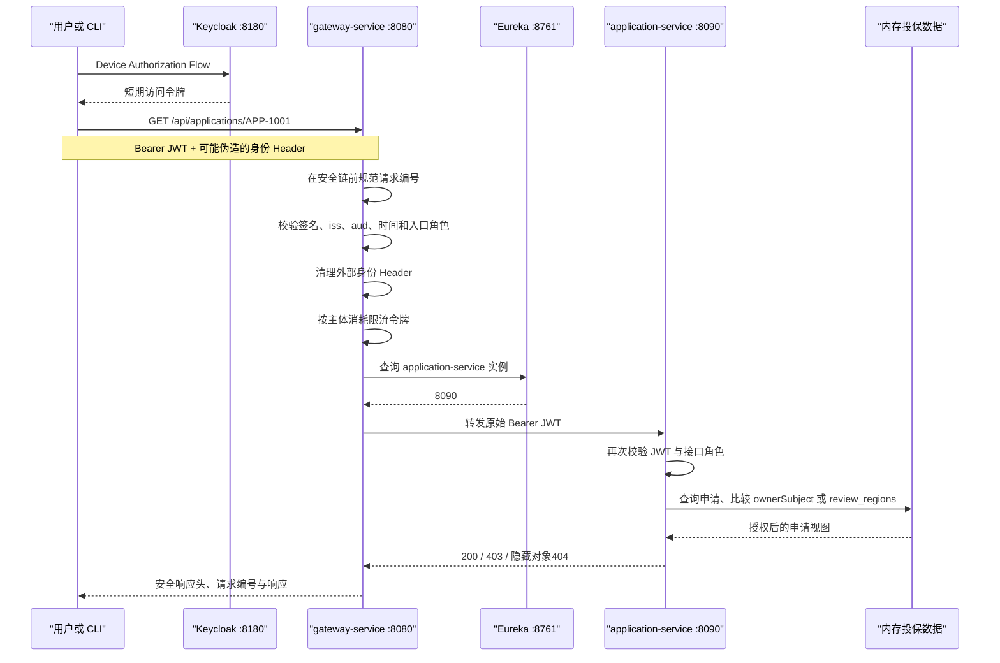

# API 网关的职责、边界与请求生命周期

API 网关不是“统一转发 Controller”，也不是把认证、业务授权、熔断、编排和数据聚合全部堆在一个进程。它位于外部调用方与内部服务之间，负责入口处可以统一判断的策略；依赖业务对象和领域状态的最终决定仍属于业务服务。

本文使用 `examples/microservices-insurance/` 的真实工程解释边界。工程采用 Java 21、Spring Boot 4.1.0、Spring Cloud 2025.1.2、Spring Cloud Gateway 5.0.2、Spring Security 7.1.0、Eureka 与 Keycloak 26.7.0。

## 一、先从一个真实请求判断责任

用户读取投保单 `APP-1001` 时，请求链路不是一次简单的 HTTP 转发：

::: details 查看读取投保单的请求时序图

:::

这条链路至少有六种不同判断。把它们都叫“鉴权”，会让代码边界和失败语义迅速混乱。

| 判断 | 所需数据 | 正确责任方 | 原因 |
|------|----------|------------|------|
| 用户如何登录 | 用户、凭证、认证流程 | Keycloak | 业务服务不应保存和校验用户密码 |
| JWT 是否可信 | 签名、`iss`、`aud`、时间 | Gateway 与业务服务 | 两层都可能被直接访问，必须独立验证 |
| 外部路径去哪里 | Path、Method、Header、服务名 | Gateway | 属于入口流量治理 |
| 是否允许调用审核接口 | 已验证角色与 HTTP 方法 | Gateway 粗筛、业务服务终判 | Gateway 减少无效流量，服务保持最终安全边界 |
| 是否能审核 `APP-1001` | 申请区域与审核范围 | `application-service` | Gateway 不拥有投保领域数据 |
| 实例是否可用 | 注册表、连接结果、超时 | Eureka、Gateway 与服务调用方 | 发现、选择、连接是不同阶段 |

## 二、Gateway适合承担哪些职责

判断一项能力是否适合放入 Gateway，可以问两个问题：

1. 所有入口是否都需要同样处理？
2. 判断是否只依赖请求、已验证身份和基础设施状态，而不依赖领域对象？

两个答案都是“是”时，通常适合放在 Gateway。

### 1. 稳定的入口职责

本工程把以下能力放在 `gateway-service`：

| 职责 | 本工程实现 | 可验证结果 |
|------|------------|------------|
| 路由 | `Path`、`Method`、实验 Header、`RewritePath`、`lb://` | 商品请求重写到内部路径，未配置方法返回 `404` |
| 入口认证 | Reactive Resource Server | 缺少或无效令牌返回 `401` |
| 粗粒度角色 | 申请查询允许申请人或审核员，审核只允许审核员 | 已认证但角色不足返回 `403` |
| Header 信任边界 | 删除五类外部身份 Header | 下游替身实际收到 `missing` |
| 请求关联 | 校验或生成 `X-Request-Id` | Gateway、下游响应和审计使用同一编号 |
| 单实例限流 | Bucket4j + 有界 Caffeine Cache | 10 秒内第 6 次请求返回 `429` |
| 浏览器边界 | 精确 CORS 与安全响应头 | 未配置 Origin 的预检返回 `403` |
| 入口审计 | 记录主体 `sub`、路径、状态、耗时 | 日志不读取 Authorization 与正文 |
| 代理失败归一 | 连接失败和无实例映射到 Problem Details | 对外稳定返回 `503` |

这些策略不需要读取申请所有者、保单状态或审核任务表，因此可以统一执行。

### 2. Gateway不能代替业务服务

以下能力不应放入本章 Gateway：

| 不应承担的能力 | 如果放入 Gateway 会发生什么 | 正确位置 |
|----------------|----------------------------|----------|
| 判断申请所有者 | Gateway 必须复制投保数据和权限规则 | `application-service` |
| 决定审核状态迁移 | 入口层变成领域事务协调器 | 投保领域服务 |
| 跨服务写事务 | 路由进程承担补偿、幂等和一致性 | Saga、工作流或领域服务 |
| 保存用户密码 | 认证协议和业务代码耦合 | 身份提供方 |
| 依靠一个 Header 声明用户 | 客户端可直接伪造身份 | 从已验证 JWT 重建主体 |
| 无限重试写请求 | 可能重复创建、扣费或审核 | 调用方按幂等语义设计 |

一个实用信号是：如果 Gateway 为完成判断需要调用多个业务服务、维护业务缓存并理解领域状态，它已经开始形成“网关单体”。

## 三、控制面、数据面与身份面必须分开

同一请求会经过三类平面，它们的可用性和一致性不同。

| 平面 | 组件 | 保存的状态 | 典型失败 |
|------|------|------------|----------|
| 身份面 | Keycloak、JWK、JWT | 用户、角色、签名密钥、令牌 | 登录失败、密钥轮换、令牌过期 |
| 控制面 | Eureka | 服务名与实例地址 | 注册表陈旧、实例尚未剔除 |
| 数据面 | Gateway、业务服务 | 正在传输的请求与响应 | 连接拒绝、超时、下游 `5xx` |

Eureka 显示实例 `UP` 只证明控制面仍有记录，不能证明数据面连接成功。Gateway 已验证 JWT 也不能证明业务服务一定能够验证：后端可能无法获取新 JWK，或者收到错误 Audience 的令牌。

生产排障时应先确定失败平面：

::: details 查看按失败平面定位问题的判断路径
```text
拿不到 Token
  → 身份面

Gateway 返回 401/403/429
  → 请求尚未进入业务服务

Gateway 返回 503
  → 路由已匹配，但服务发现或连接阶段失败

业务服务返回隐藏对象 404
  → 身份已验证，最终对象授权失败
```
:::

## 四、一次请求在Gateway中的真实生命周期

本工程的关键顺序如下：

::: details 查看 Gateway 处理请求的完整顺序
```text
WebFilter：规范请求编号
  → WebFilter：CORS 与 Spring Security
  → 认证 JWT、建立 Principal、执行路径角色规则
  → GlobalFilter：删除身份 Header
  → GlobalFilter：主体限流
  → GlobalFilter：安全审计外层
  → Route Predicate 匹配
  → Route Filter 路径重写
  → LoadBalancer 根据服务名选择实例
  → Netty 建立下游连接
  → 响应过滤、安全 Header 与审计收尾
```
:::

顺序直接影响安全结论：

- 限流需要认证后的 `sub`，不能只按可修改用户名计数；
- 身份 Header 必须在代理前删除；
- 请求编号要位于 Spring Security 之前，`401/403` 才能与拒绝日志关联；
- 路由阶段审计要包裹下游调用，才能记录最终状态和耗时；
- 代理错误处理必须在路由链外层，才能把连接失败映射成 `503`；
- CORS 是浏览器读取响应的规则，不是服务端认证替代品。

## 五、错误状态是架构契约

状态码不应由异常类偶然决定。本工程固定以下契约：

| 状态 | 何时返回 | 客户端应如何处理 | 不应泄露的内容 |
|------|----------|------------------|----------------|
| `401` | 没有 Token、签名或 Claim 无效 | 重新登录或获取新 Token | 解析堆栈、密钥 ID 内情 |
| `403` | 身份合法但接口角色不足 | 不重试，申请权限或改变操作 | 所需全部角色与内部策略 |
| `404` | 路由不存在、对象不存在或不可观察 | 按资源不可用处理 | 对象是否真实存在 |
| `429` | 主体额度耗尽 | 按 `Retry-After` 延迟 | 其他用户额度 |
| `503` | 无可用实例或下游连接失败 | 按调用预算有限重试 | 下游 IP、端口和异常类 |

Gateway 和业务服务都使用 `application/problem+json`。一个 `503` 响应的结构为：

```json
{
  "type": "https://example.com/problems/service-unavailable",
  "title": "Service unavailable",
  "status": 503,
  "detail": "The requested service is temporarily unavailable.",
  "instance": "/api/applications/APP-1001",
  "requestId": "2c7b1fa0-41e5-4ba7-a2c8-9ce2d6148922"
}
```

`requestId` 供调用方报障和日志关联，不用于身份或授权。

## 六、用失败实验验证边界

只验证成功请求会遗漏最重要的架构事实。本工程的自动化测试包含以下反例：

| 实验 | 输入 | 实际结论 |
|------|------|----------|
| 内部路径探测 | `GET /internal/products/HEALTH-001` 访问 Gateway | `404`，内部接口未暴露 |
| 方法越界 | `POST /api/products/HEALTH-001` | `404`，路由不只按 Path |
| Header 身份伪造 | 外部 `X-User-Id`、`X-Roles` | 下游实际未收到 |
| Gateway 绕过 | 直接请求 `8090`，只有身份 Header | `401` |
| 跨用户读取 | `applicant-b` Token 读取 `APP-1001` | 隐藏对象 `404` |
| 跨区域审核 | EAST 审核员操作 WEST 申请 | 隐藏对象 `404` |
| 下游停服 | application-service 端口不可连接 | Problem Details `503` |
| 超过额度 | 同一主体连续 6 次调用 | 第 6 次 `429` |

这些实验分别证明路径边界、身份边界、对象边界和容量边界，不能互相替代。

## 七、是否需要Gateway的决策表

Gateway 会增加部署、延迟和故障面，不是所有系统都必须引入。

| 场景 | 建议 | 原因 |
|------|------|------|
| 单体应用只有一个公开入口 | 暂不引入独立 Gateway | Web 框架已经能处理认证、限流和路由 |
| 多个服务直接暴露且策略重复 | 引入 | 统一域名、认证和入口治理开始产生价值 |
| BFF 需要按终端聚合读模型 | 可以引入独立 BFF | 避免通用 Gateway 混入大量页面业务 |
| 服务间调用需要零信任身份 | Gateway 不够 | 还需要服务身份、mTLS 或服务网格 |
| 只是为了隐藏真实 IP | 先评估反向代理 | Nginx、云负载均衡可能已经满足 |
| 团队无法运维额外关键组件 | 暂缓 | Gateway 故障会影响全部外部流量 |

## 八、生产设计检查

上线前至少回答以下问题：

1. 哪些路径允许匿名，哪些要求角色，规则是否有自动化测试？
2. 业务服务能否被绕过 Gateway，绕过后是否仍验证 JWT？
3. 谁签发 Token，资源服务如何验证 `iss`、`aud` 和密钥轮换？
4. 外部可控 Header 是否会被任何服务当成身份？
5. 无实例、连接失败、超时和下游 `5xx` 是否能被区分？
6. 限流是单实例还是分布式，重启和扩容时额度如何变化？
7. 日志是否包含 Token、密码、邮箱、请求正文或下游地址？
8. Gateway 发布失败时如何回滚，配置变化如何灰度？

::: warning 本地实验不是生产部署模板
本章使用 `start-dev` Keycloak、HTTP、本地 H2、Eureka 单节点和 Gateway 单实例，目的是让机制可观察。生产环境需要 TLS、持久数据库、密钥与密码管理、多实例容量、配置发布、指标告警和灾难恢复。
:::

## 九、验证入口与下一步

在示例根目录运行全部自动化测试：

```powershell
.\mvnw.cmd clean verify
```

当前实现中，`application-service` 的安全与对象权限测试为 16 项，`gateway-service` 的路由、JWT、Header、CORS、错误和限流测试为 14 项。测试通过能证明这些确定性行为，但不能替代真实 Keycloak 登录和多进程故障实验。

下一篇将进入 Spring Cloud Gateway 5.0.2 的 Route、Predicate、Filter、`lb://` 与过滤顺序，使用真实下游替身解释“配置为什么产生这个请求结果”。
