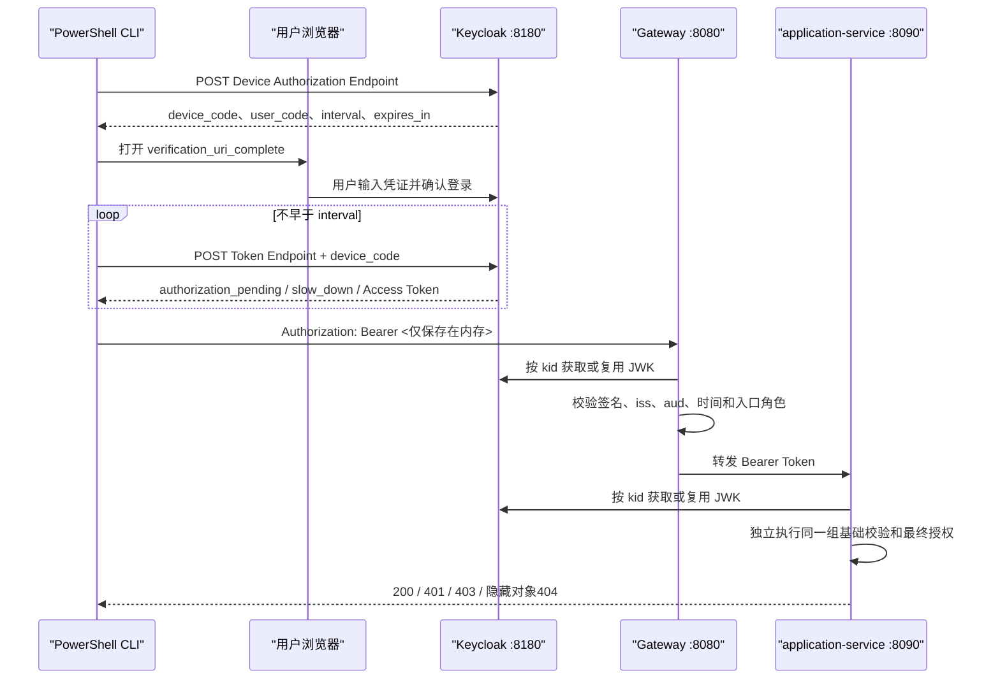

# OAuth 2.0、OIDC 与 JWT 实践

拿到一个三段式字符串，不等于完成认证；能够 Base64Url 解码 JWT，也不等于令牌可信。资源服务只有验证签名、发行方、受众和时间约束，再把受控 Claim 映射为权限，才能使用其中的身份。

本文在 `examples/microservices-insurance/` 中运行 Keycloak 26.7.0，通过 OAuth 2.0 Device Authorization Flow 获取真实访问令牌。Gateway 和 `application-service` 都是独立 Resource Server，不依赖“请求经过了上一层”建立信任。

## 一、先拆清四个容易混用的概念

四个概念解决的问题不同：

| 概念 | 解决的问题 | 本实验中的体现 | 不负责什么 |
|------|------------|----------------|------------|
| OAuth 2.0 | 客户端如何获得并使用访问授权 | Device Authorization Flow、Access Token | 不规定用户资料模型 |
| OpenID Connect（OIDC） | 在 OAuth 2.0 上表达用户认证结果 | `openid` Scope、Issuer 元数据、用户身份 Claim | 不替资源服务决定对象权限 |
| JWT | 如何把 Claim 封装并签名 | Keycloak 签发 RS256 Access Token | 不规定客户端应选哪种授权流程 |
| Resource Server | 如何验证 Token 并保护 API | Gateway 与 `application-service` | 不负责收集用户密码 |

本实验的参与者关系如下：



浏览器把用户凭证提交给 Keycloak，CLI 只拿授权结果。Gateway 和业务服务都不接触密码。

## 二、为什么命令行实验选择Device Flow

授权流程必须按客户端能力选择，而不是看到 Token Endpoint 就提交用户名和密码。

| 客户端场景 | 推荐方向 | 原因 |
|------------|----------|------|
| 有系统浏览器的 CLI、电视或输入受限设备 | Device Authorization Flow | 客户端不收集密码，也不必在本地监听回调端口 |
| 浏览器或移动端公开客户端 | Authorization Code + PKCE | 通过浏览器登录，授权码与 PKCE 绑定 |
| 有安全后端的 Web 应用 | Authorization Code，机密客户端凭证保存在后端 | 浏览器不持有 Client Secret |
| 服务调用服务 | Client Credentials 或工作负载身份 | 没有终端用户交互 |
| 把用户名和密码直接发给 Token Endpoint | 本实验禁用 | 客户端获得用户凭证，扩大泄露与钓鱼风险 |

Realm 中的 `insurance-cli` 是公开客户端，没有可保密的 Client Secret：

```json
{
  "clientId": "insurance-cli",
  "publicClient": true,
  "standardFlowEnabled": false,
  "directAccessGrantsEnabled": false,
  "serviceAccountsEnabled": false,
  "attributes": {
    "oauth2.device.authorization.grant.enabled": "true"
  }
}
```

`publicClient: true` 不是“允许匿名调用 API”，而是说明这个客户端无法安全保存 Secret。API 是否允许请求，仍由访问令牌和 Resource Server 决定。

## 三、准备可重复的Keycloak Realm

本实验使用以下已实际运行的环境：

| 组件 | 版本或配置 | 作用 |
|------|------------|------|
| JDK | 21.0.11 | 启动 Keycloak 与 Spring 服务 |
| Keycloak | 26.7.0，`start-dev` | 身份提供方，仅用于本地实验 |
| Realm | `insurance-lab` | 隔离实验用户、角色和客户端 |
| Access Token 生命周期 | 60 秒 | 缩短令牌过期观察时间 |
| 签名公钥 | Realm JWK Set | Resource Server 按 `kid` 验签 |
| API Audience | `insurance-api` | 防止其他资源的 Token 被误用 |

`scripts/prepare-keycloak.ps1` 会把 Keycloak 安装到仓库外，下载完成后同时校验官方制品大小和 SHA-256。本次校验结果为：

```text
Version          : 26.7.0
JavaMajor        : 21
ArchiveSize      : 175957473
Sha256           : e63bd0167199c0092b8a4d22cc137e6b7a70e0089070f6f7799b1be504b69a8a
```

Realm 文件使用环境变量占位符，不在仓库保存实验密码。第一次运行按以下顺序准备和启动：

```powershell
# examples/microservices-insurance/
.\scripts\prepare-keycloak.ps1
$securePassword = Read-Host '为三个本地实验用户设置临时密码' -AsSecureString
$env:INSURANCE_LAB_USER_PASSWORD = [System.Net.NetworkCredential]::new('', $securePassword).Password
.\scripts\start-gateway-security-lab.ps1
$env:INSURANCE_LAB_USER_PASSWORD = $null
$securePassword = $null
```

启动脚本会检查 `8080`、`8180`、`8090`、`8081`、`8082` 与 `8761`，拒绝覆盖已有监听进程；实验进程记录在被 Git 忽略的 PID 文件中。Keycloak 的 `data` 只会在已验证的仓库外安装目录内重建。

::: danger 不要把本地密码做成示例常量
Realm 中的 `${INSURANCE_LAB_USER_PASSWORD}` 会在导入时解析。不要把真实密码、固定教学密码、Client Secret 或生产地址写回 JSON、脚本、Markdown 和命令历史。
:::

## 四、Device Authorization Flow如何执行

CLI 先读取 OIDC Discovery 元数据，而不是拼接所有端点：

```powershell
$issuer = 'http://localhost:8180/realms/insurance-lab'
$metadata = Invoke-RestMethod -Uri "$issuer/.well-known/openid-configuration"
```

然后向 `device_authorization_endpoint` 提交公开的 Client ID 和 Scope：

```powershell
$deviceResponse = Invoke-RestMethod `
    -Uri $metadata.device_authorization_endpoint `
    -Method Post `
    -ContentType 'application/x-www-form-urlencoded' `
    -Body @{
        client_id = 'insurance-cli'
        scope = 'openid profile'
    }
```

响应字段必须区分用途：

| 字段 | 谁使用 | 安全处理 |
|------|--------|----------|
| `verification_uri` | 用户 | 可以显示，用户手工输入代码 |
| `verification_uri_complete` | 浏览器 | 可以直接打开，已经携带用户代码 |
| `user_code` | 用户 | 短期展示，不是 API Token |
| `device_code` | CLI 与 Token Endpoint | 只留内存，不写日志 |
| `interval` | CLI | 控制最短轮询间隔 |
| `expires_in` | CLI | 到期后停止轮询并重新开始 |

轮询不能写成无间隔死循环。Keycloak 返回 `authorization_pending` 时保持当前间隔，返回 `slow_down` 时增加间隔：

```powershell
# scripts/run-authenticated-scenario.ps1 中的局部逻辑
switch ($ErrorBody.error) {
    'authorization_pending' { return $CurrentInterval }
    'slow_down' { return $CurrentInterval + 5 }
    'access_denied' { throw '用户拒绝了 Device Flow 授权。' }
    'expired_token' { throw 'Device Code 已过期，请重新执行脚本。' }
    default { throw "Token Endpoint 返回未处理错误：$($ErrorBody.error)" }
}
```

启动全部服务后，执行本人对象场景：

```powershell
.\scripts\run-authenticated-scenario.ps1 -Scenario OwnedApplication
```

脚本打开系统浏览器。使用 `applicant-a` 登录后，它只输出安全 Claim 摘要、HTTP 状态和请求编号，不输出 Access Token。真实联调结果为：

```text
flow      : device_authorization
username  : applicant-a
subject   : 11111111-1111-1111-1111-111111111111
audience  : insurance-api
roles     : applicant
apiStatus : 200
```

## 五、JWT验证不是解码Payload

JWT 由 Header、Payload 和 Signature 三段组成。Payload 的 Base64Url 编码不提供保密性，任何拿到 Token 的进程都能解码 Claim。可信结论来自签名验证与约束验证：

```text
读取 JWT Header.kid
  → 在受信 Issuer 的 JWK Set 中选择公钥
  → 验证 RS256 Signature
  → 验证 iss 等于配置的 Realm Issuer
  → 验证 aud 包含 insurance-api
  → 验证 nbf、iat、exp 与允许的时钟偏差
  → 把已验证的 realm_access.roles 映射为 Authority
```

本实验实际使用的关键 Claim 如下：

| Claim | 示例值 | 使用方式 | 错误用法 |
|-------|--------|----------|----------|
| `iss` | `http://localhost:8180/realms/insurance-lab` | 限定受信发行方 | 只要签名能解就接受 |
| `sub` | 固定 UUID | 所有权、限流和审计的稳定主体 | 用可修改用户名作为主键 |
| `aud` | `insurance-api` | 限定 Token 的目标资源 | 接受发给 `account-api` 的 Token |
| `exp` | Unix 时间 | 拒绝超过有效期和时钟偏差的 Token | 只在客户端检查 |
| `preferred_username` | `applicant-a` | 展示和诊断 | 作为所有权唯一标识 |
| `realm_access.roles` | `applicant` | 映射 `ROLE_APPLICANT` | 信任客户端传入 `X-Roles` |
| `review_regions` | `EAST` | 后端对象级审核范围 | 在 Gateway 复制投保对象规则 |

::: warning JWT Payload不是敏感数据容器
签名防篡改，不加密 Payload。不要把密码、证件号、完整联系方式或其他不应被客户端读取的数据放入普通签名 JWT。
:::

## 六、Gateway与业务服务独立验签

Gateway 使用响应式 `ReactiveJwtDecoder`，`application-service` 使用 Servlet `JwtDecoder`，但校验结论相同：

```java
// gateway/security/GatewaySecurityConfiguration.java
NimbusReactiveJwtDecoder decoder = NimbusReactiveJwtDecoder
        .withJwkSetUri(jwkSetUri)
        .build();
decoder.setJwtValidator(new DelegatingOAuth2TokenValidator<>(
        JwtValidators.createDefaultWithIssuer(issuerUri),
        new RequiredAudienceValidator(audience)
));
```

```java
// application/security/ApplicationSecurityConfiguration.java
NimbusJwtDecoder decoder = NimbusJwtDecoder
        .withJwkSetUri(jwkSetUri)
        .build();
decoder.setJwtValidator(new DelegatingOAuth2TokenValidator<>(
        JwtValidators.createDefaultWithIssuer(issuerUri),
        new RequiredAudienceValidator(audience)
));
```

Spring 的默认 Issuer Validator 覆盖发行方和时间约束，本工程额外增加 Audience Validator：

```java
// gateway/security/RequiredAudienceValidator.java
@Override
public OAuth2TokenValidatorResult validate(Jwt token) {
    if (token.getAudience() != null
            && token.getAudience().contains(requiredAudience)) {
        return OAuth2TokenValidatorResult.success();
    }
    return OAuth2TokenValidatorResult.failure(INVALID_AUDIENCE);
}
```

后端直接监听 `8090` 是有意保留的绕过实验。只有伪造 `X-User-Id` 和 `X-Roles`、没有 Bearer Token 时，后端真实返回 `401`；这证明业务服务没有把 Gateway 网络位置当成认证。

## 七、用失败矩阵证明Token边界

只验证一个成功 Token 无法证明安全配置。自动化测试与真实联调覆盖以下失败：

| 输入或状态 | Gateway | application-service | 证明的约束 |
|------------|---------|---------------------|------------|
| 缺少 Token | `401` | `401` | 受保护路径不能匿名访问 |
| 未知私钥签名 | 拒绝 | 拒绝 | 不能只解码 Payload |
| 签名正确但 `aud=account-api` | 拒绝 | 拒绝 | Token 不能跨资源复用 |
| `applicant-b` Token + 伪造 applicant-a Header | 隐藏对象 `404` | 隐藏对象 `404` | 主体来自 Token，不来自 Header |
| applicant 调用审核接口 | `403` | `403` | 认证不等于拥有接口角色 |
| Token 到达 `exp` 后约 2 秒 | `200` | 请求通过 | 默认时间校验容忍时钟偏差 |
| Token 到达 `exp` 后 64 秒 | `401` | 未转发 | 超过默认偏差后过期约束生效 |

最后两行是本次真实运行结果。Spring Security 默认时间校验为分布式节点保留时钟偏差窗口，因此不能把 `exp` 后一两秒仍成功直接判定为“没有验证过期”。若业务需要缩小窗口，应显式配置 `JwtTimestampValidator` 的 `clockSkew`，同时先保证所有节点可靠同步时间；不能只改 Gateway 而让业务服务保留不同规则。

## 八、自动化测试和真实IdP测试各自证明什么

`GatewaySignedJwtTest` 与 `ApplicationSignedJwtTest` 每次测试都在内存生成新的 2048 位 RSA 密钥，不保存私钥：

```java
KeyPair trustedKey = createKeyPair();
String token = encodeToken("insurance-api", trustedKey);

Jwt decoded = createDecoder(trustedKey).decode(token);
```

每个 Resource Server 都有三类确定性用例：正确签名和 Audience、错误 Audience、未知签名密钥。它们运行快，能准确定位校验器回归，但不能证明 Realm 导入、Discovery 元数据、Device Flow 和浏览器登录可用。

真实 Keycloak 联调补充了以下证据：

| 真实环节 | 已观察结果 |
|----------|------------|
| Realm 环境变量导入 | 三名用户可以登录，仓库没有固定密码 |
| Device Flow | 浏览器完成登录，CLI 从 Token Endpoint 获得 Token |
| Realm 角色和自定义 Claim | applicant、reviewer 与 `review_regions=EAST` 正确签发 |
| 双层 Resource Server | 通过 Gateway 和直接访问后端都执行 JWT 校验 |
| Token 过期 | `exp + 64s` 返回 `401` |
| 日志边界 | 审计记录主体、路径、状态和请求编号，不记录 Bearer Token |

两类测试不能互相替代。单元测试保证失败分支可重复，真实 IdP 测试保证协议与配置能连起来。

## 九、密钥轮换与身份服务故障如何判断

资源服务根据 JWT Header 的 `kid` 从 JWK Set 选择公钥。正常情况下会缓存已获取的密钥，避免每个 API 请求都访问 Keycloak；出现新 `kid` 时需要刷新 JWK。由此产生三种不同状态：

| 状态 | 可能结果 | 排查证据 |
|------|----------|----------|
| 旧 Token、对应 JWK 已缓存 | Keycloak 短暂不可用时仍可能验证 | Resource Server 没有远程请求，签名与 Claim 仍有效 |
| 新 Token 使用新 `kid` | 需要获取更新后的 JWK Set | Header `kid`、JWK Set、获取错误日志 |
| Token 已过期 | 即使旧公钥仍缓存也必须拒绝 | `exp`、服务器时间和时钟偏差配置 |

不要把“资源服务某次还能验证 Token”解释成“Keycloak 故障没有影响”。登录、刷新令牌、新密钥获取和旧 Token 本地验证是不同路径，必须分别监控。生产轮换需要保留旧公钥覆盖旧 Token 的最大有效期，并验证所有 Resource Server 都能获取新 JWK。

## 十、生产落地边界与验证入口

本地实验有意使用 HTTP、`start-dev`、H2 和单实例。生产至少还要补齐：

1. Keycloak 使用生产启动模式、TLS、持久数据库、备份和高可用；
2. Issuer 使用稳定 HTTPS 域名，不能因内外网地址不同产生两个 `iss`；
3. Client 类型、Redirect URI、PKCE、Secret 和 Scope 按真实客户端建模；
4. Access Token 生命周期、时钟偏差、刷新策略和会话撤销形成统一策略；
5. JWK 获取超时、缓存、轮换与身份面故障设置指标和告警；
6. Gateway 与每个业务服务保持一致的 Issuer、Audience 和时间校验；
7. 日志、链路和错误响应不得记录 Token、密码、授权码与 Device Code。

运行无需登录的安全反例：

```powershell
.\scripts\verify-unauthenticated-scenarios.ps1
```

运行真实登录场景后停止全部实验进程：

```powershell
.\scripts\run-authenticated-scenario.ps1 -Scenario ForgedIdentityHeader
.\scripts\run-authenticated-scenario.ps1 -Scenario ReviewEast
.\scripts\run-authenticated-scenario.ps1 -Scenario ReviewWest
.\scripts\run-authenticated-scenario.ps1 -Scenario RateLimit
.\scripts\stop-gateway-security-lab.ps1
```

进一步核对协议和服务器配置时，使用 [Keycloak Server Administration Guide](https://www.keycloak.org/docs/latest/server_admin/)、[Keycloak Import and Export Guide](https://www.keycloak.org/server/importExport) 与 [Spring Security OAuth 2.0 Resource Server JWT 文档](https://docs.spring.io/spring-security/reference/servlet/oauth2/resource-server/jwt.html)。

下一篇将使用同一批真实 Token 继续讨论接口角色、对象所有权、审核区域和可信身份上下文，解释合法 Token 为什么仍可能得到 `403` 或隐藏对象 `404`。
