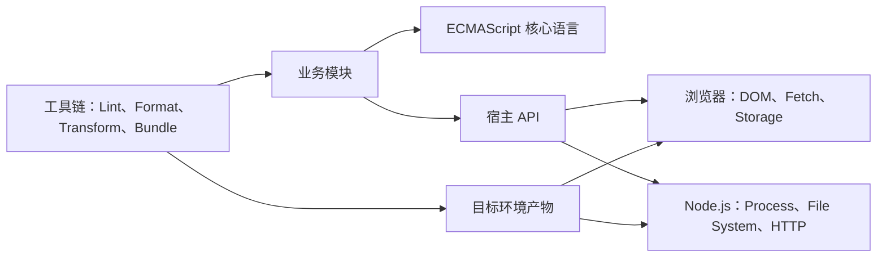
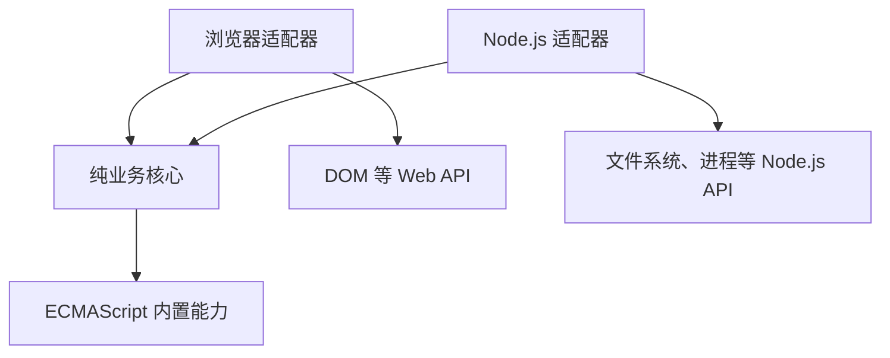

# JavaScript 语言边界

JavaScript 项目中的能力并不都来自 JavaScript 语言本身。`Promise`、`Array` 和 `import` 属于 ECMAScript；`document`、`fetch` 和 `setTimeout` 由宿主环境提供；JSX、路径别名和环境变量替换通常来自构建工具。先判断能力属于哪一层，才能正确分析兼容性、运行时差异和报错来源。

本文以 2026-07-29 可用的 ECMAScript、Web 平台和 Node.js 官方资料为依据，重点建立语言边界，不展开类型、异步、DOM 和模块化的完整用法。

## 一、JavaScript 能力的三层模型

### 1. ECMAScript 定义核心语言

ECMAScript 是 JavaScript 核心语言的标准。它规定源代码如何解析和执行，以及不同实现必须遵守的语言语义。浏览器、Node.js 等运行时可以实现同一套 ECMAScript 语言，但不必提供相同的输入输出能力。

ECMAScript 主要定义以下内容：

- 语法和控制流，例如变量声明、函数、类、异常和模块语法；
- 语言类型，例如 `Undefined`、`Null`、`Boolean`、`Number`、`BigInt`、`String`、`Symbol` 和 `Object`；
- 内置对象，例如 `Array`、`Map`、`Set`、`Promise`、`JSON` 和 `Math`；
- 作用域、原型链、严格模式、执行上下文和内存模型；
- Promise 反应任务等语言级任务，但不规定浏览器或 Node.js 的完整事件循环。

::: tip 判断结论
一项能力能在 ECMA-262 规范中找到定义，才可以把它视为 ECMAScript 核心能力。某个 API 恰好能在多个运行时使用，不等于它已经成为 ECMAScript 的一部分。
:::

### 2. 宿主环境连接外部世界

ECMAScript 会把部分能力留给宿主定义。宿主环境负责创建全局对象、加载模块、调度任务，并通过额外 API 让程序访问页面、网络、文件系统或进程信息。

常见宿主及其典型能力如下：

| 宿主环境 | 典型全局能力 | 主要边界 |
|----------|--------------|----------|
| 浏览器页面 | `document`、`location`、`localStorage`、`fetch` | 可以操作页面并受同源策略、CORS 和页面生命周期约束 |
| Web Worker | `self`、`postMessage`、`fetch` | 没有 `document`，不能直接操作页面 DOM |
| Node.js | `process`、`Buffer`、`fetch`、`node:fs` | 可以访问进程和文件系统，默认没有页面 DOM |

`fetch` 和定时器是容易误判的例子。它们不是 ECMAScript 核心能力，但浏览器和 Node.js 都可以提供相似接口。相反，`document` 与页面结构绑定，Node.js 默认不会提供该对象。

### 3. 工具链改变开发和交付方式

构建工具、转译器、代码检查器和框架位于语言与宿主之外。它们可以转换源代码、约束代码质量或注入构建时数据，但不能改变目标运行时实际拥有的能力。

| 能力 | 常见提供者 | 是否属于 ECMAScript |
|------|------------|----------------------|
| JSX、TypeScript 类型语法 | Babel、TypeScript、构建工具 | 否 |
| `@/utils` 路径别名 | Vite、webpack、TypeScript 配置 | 否 |
| `import.meta.env` 中的构建变量 | Vite 等构建工具 | 否 |
| 语法降级 | Babel、SWC、Oxc、esbuild | 否 |
| `Array.prototype.map` | ECMAScript | 是 |
| `document.querySelector` | DOM 和 HTML 规范、浏览器宿主 | 否 |

转译只负责把一种语法变成另一种语法。目标环境缺少某个运行时 API 时，还需要 polyfill、替代实现或功能降级，不能只依赖语法转换。

### 4. 三层能力如何协作

下面的关系图展示了业务代码在运行和构建阶段依赖的不同边界：



图中的工具链在交付前处理代码，宿主 API 在程序运行时提供能力。将二者混为一谈，常见后果是开发环境可运行，而浏览器直开、服务端渲染或生产构建后失败。

## 二、全局对象不等于全局能力相同

### 1. 使用 globalThis 访问当前全局对象

`globalThis` 是 ECMAScript 提供的跨环境全局对象入口。它解决了浏览器页面常用 `window`、Worker 常用 `self`、Node.js 历史上常用 `global` 的命名差异，但不会抹平这些环境提供的属性差异。

例如，以下表达式在不同环境中的结果不同：

| 检测表达式 | 浏览器页面 | Web Worker | Node.js |
|------------|------------|------------|---------|
| `typeof globalThis.document` | 通常为 `"object"` | `"undefined"` | `"undefined"` |
| `typeof globalThis.process` | 通常为 `"undefined"` | `"undefined"` | 通常为 `"object"` |
| `typeof globalThis.fetch` | 现代浏览器通常为 `"function"` | 现代 Worker 通常为 `"function"` | 受 Node.js 版本约束 |

表格描述的是典型标准环境。测试框架、桌面壳或用户注入脚本可能增加全局属性，因此业务代码仍应检测所需的具体能力，而不是只猜测运行时名称。

### 2. 通过能力检测决定是否调用

下面是一个局部示例，用于输出当前环境拥有的关键能力。该函数不根据 User-Agent 猜测浏览器，而是直接检查代码真正需要的对象。

```javascript
// src/runtime/read-capabilities.js

/**
 * 读取当前运行时暴露的页面、进程和网络能力。
 * @returns {{ hasDom: boolean, hasNodeProcess: boolean, hasFetch: boolean }} 能力检测结果。
 */
export function readRuntimeCapabilities() {
  return {
    hasDom: typeof globalThis.document !== "undefined",
    hasNodeProcess:
      typeof globalThis.process !== "undefined" &&
      Boolean(globalThis.process?.versions?.node),
    hasFetch: typeof globalThis.fetch === "function",
  };
}
```

在 Node.js 24 LTS 中，典型结果如下。输出只表示能力是否存在，不证明远程地址一定可访问：

```json
{
  "hasDom": false,
  "hasNodeProcess": true,
  "hasFetch": true
}
```

在现代浏览器页面中，典型结果如下：

```json
{
  "hasDom": true,
  "hasNodeProcess": false,
  "hasFetch": true
}
```

::: warning 能力检测的边界
`typeof fetch === "function"` 只能证明入口存在。权限策略、CORS、网络状态和 API 参数支持情况仍需在实际调用时处理。不要把“属性存在”扩展解释为“业务操作一定成功”。
:::

## 三、语言模块与模块加载不是同一层

### 1. ECMAScript 规定模块语法和语义

ECMAScript 定义 `import`、`export`、模块作用域、链接和求值语义。ES Module 自动使用严格模式，同一个模块实例通常只求值一次，模块内部声明也不会自动成为全局属性。

下面的代码属于语言层模块语法：

```javascript
// src/core/price.js
export const currency = "CNY";
```

```javascript
// src/main.js
import { currency } from "./core/price.js";

console.log(currency);
```

其中 `import` 和 `export` 的语义由 ECMAScript 定义，但 `"./core/price.js"` 如何定位、读取和缓存，需要宿主参与。

### 2. 宿主决定模块标识符如何解析

浏览器通常把相对模块标识符解析为 URL，并要求服务器返回正确的 JavaScript MIME 类型。Node.js 会结合文件 URL、扩展名、最近的 `package.json`、`"type"` 和包的 `"exports"` 等规则解析模块。

| 场景 | 浏览器原生 ESM | Node.js ESM |
|------|----------------|-------------|
| 相对导入 | 通常需要可解析的 URL 和文件扩展名 | 相对文件导入需要明确扩展名 |
| 包名导入 | 需要 import map 或构建工具处理 | 可以按 Node.js 包解析规则加载 |
| `.js` 的模块类型 | 由 `<script type="module">` 等加载上下文确定 | 受最近的 `package.json` 中 `"type"` 影响 |
| 文件获取 | 通过网络或缓存获取 | 通常从文件系统或包中读取 |

因此，某段 ESM 代码语法正确，不代表它能在所有宿主中使用同一模块标识符成功加载。

### 3. 模块执行错误的定位顺序

遇到模块错误时，应按以下顺序判断：

1. 检查 `import`、`export` 是否满足 ECMAScript 语法；
2. 检查当前文件是否被宿主按 ESM 解析；
3. 检查模块标识符是否符合当前宿主的解析规则；
4. 检查目标资源是否存在，并确认扩展名、MIME 类型和访问权限；
5. 最后再检查循环依赖、顶层副作用和求值顺序。

浏览器通过 `file://` 直接打开包含模块的 HTML 时，可能因为模块安全要求和 CORS 限制加载失败。应通过本地 HTTP 服务测试，而不是把该问题误判为 `import` 语法不受支持。

## 四、异步语义与事件循环的边界

### 1. ECMAScript 定义 Promise 任务

ECMAScript 规定 Promise 的状态、反应处理和相关 Job 语义。例如，已经完成的 Promise 调用 `.then()` 时，回调不会在当前同步调用栈中直接执行。

以下代码用于观察同步代码与 Promise 反应的顺序：

```javascript
// examples/promise-order.js
console.log("同步开始");

Promise.resolve().then(
  /**
   * 输出 Promise 反应任务的执行位置。
   * @returns {void} 仅产生一条日志。
   */
  function logPromiseReaction() {
    console.log("Promise 回调");
  },
);

console.log("同步结束");
```

预期输出如下：

```text
同步开始
同步结束
Promise 回调
```

该示例能证明 Promise 回调不会插入当前同步调用栈，但不能单独描述浏览器渲染、Node.js I/O 阶段或所有任务源的完整调度顺序。

### 2. 宿主定义事件循环和 I/O 调度

浏览器的事件循环、定时器、网络回调和渲染机会主要由 HTML 等 Web 规范定义。Node.js 则在自身事件循环和底层 I/O 模型中集成 ECMAScript 任务。

因此需要区分以下结论：

- `Promise` 属于 ECMAScript；
- `setTimeout` 由宿主提供；
- 定时器延迟是最小等待时间，不是精确执行时刻；
- 页面渲染步骤是浏览器行为，Node.js 不存在同等页面渲染阶段；
- 一段代码在两种宿主中输出顺序相同，不代表两者的完整事件循环实现相同。

## 五、跨运行时代码的边界设计

### 1. 将纯业务逻辑与宿主适配器分开

可复用模块不应在核心逻辑中直接读取 `document`、`process.env` 或文件系统。更稳妥的结构是把确定性的业务计算放在核心模块，把输入输出放在浏览器或 Node.js 适配器中。

```text
src/
├── core/
│   └── order-summary.js
├── browser/
│   └── render-order-summary.js
└── node/
    └── write-order-summary.js
```

这种结构形成明确依赖方向：



核心模块只依赖 ECMAScript 能力，浏览器和 Node.js 适配器分别承担宿主差异。测试核心模块时不需要模拟 DOM 或文件系统，迁移运行时也只需替换边缘适配器。

### 2. 不用运行时猜测代替依赖注入

当核心逻辑需要时间、随机数、网络请求或持久化能力时，优先通过参数传入依赖。大量使用 `typeof window` 分支会让同一模块承担多个宿主职责，增加测试组合和打包风险。

| 情况 | 推荐方式 | 原因 |
|------|----------|------|
| 只在浏览器渲染页面 | 放入 browser 适配器 | 明确依赖 DOM |
| 只在服务端读取文件 | 放入 node 适配器 | 避免浏览器构建包含 `node:fs` |
| 两端共享金额计算 | 放入 core 模块 | 输入相同即可得到相同结果 |
| 两端都要请求数据 | 注入请求函数或建立各自适配器 | 可分别处理凭证、超时和错误 |

只有库代码确实需要在多个未知宿主中自适应，并且无法由调用方选择入口时，才应使用能力检测分支。

## 六、常见越界错误与定位证据

### 1. 根据错误归属选择修复方式

常见问题可以按语言、宿主和工具链三层定位：

| 错误现象 | 所属边界 | 定位证据 | 正确处理 |
|----------|----------|----------|----------|
| `ReferenceError: window is not defined` | 宿主 API | 当前环境没有页面全局对象 | 将 DOM 逻辑移到浏览器入口，或在客户端生命周期中调用 |
| `ReferenceError: require is not defined in ES module scope` | Node.js 模块加载 | 当前文件按 ESM 解析 | 使用 `import`，或明确建立 CommonJS 边界 |
| `ERR_MODULE_NOT_FOUND` | 模块解析或文件组织 | 标识符无法由当前宿主解析 | 检查路径、扩展名、包入口和 `"exports"` |
| 浏览器报告 CORS 错误 | Web 安全与网络 | 控制台和 Network 面板显示跨源策略拦截 | 调整服务端响应、请求模式或同源部署 |
| `document is not defined` | DOM 宿主能力 | 代码在 Worker 或 Node.js 执行 | 改由页面线程操作 DOM，并通过消息或参数传递数据 |
| 源代码支持但旧浏览器报语法错误 | 构建目标 | 产物仍包含目标环境不支持的语法 | 校准构建 target，并在目标浏览器验证产物 |

### 2. 三个高频误区

::: warning JavaScript 不等于浏览器
DOM、CORS、页面渲染和本地存储属于 Web 平台。学习 JavaScript 核心语法时，应把这些能力标记为宿主依赖。
:::

::: warning Node.js 支持某 API 不代表它属于 ECMAScript
Node.js 可以实现 `fetch`、`URL` 等 Web 兼容 API。这表示宿主之间出现能力交集，不表示 ECMA-262 已定义这些 API。
:::

::: warning 构建成功不等于运行时兼容
构建工具能够识别源代码，只能证明构建阶段通过。最终产物仍需在声明的浏览器或 Node.js 版本中执行验证。
:::

## 七、API 归属判断流程

### 1. 按证据来源逐层确认

面对陌生 API 时，可以执行以下流程：

1. 在 ECMA-262 中确认是否存在语言级定义；
2. 若涉及页面、网络、存储或 Worker，在 WHATWG、W3C 或 MDN 的 Web API 文档中查找；
3. 若涉及文件、进程、Buffer 或 Node.js 包解析，查看对应 Node.js 版本文档；
4. 若名称带有框架或工具特征，检查构建工具、框架和插件文档；
5. 根据项目声明的目标环境进行能力检测和真实运行验证；
6. 记录不支持时的降级、替代或阻断策略。

### 2. 用决策表约束使用方式

| 判断结果 | 项目中的使用方式 |
|----------|------------------|
| ECMAScript 核心能力，目标环境原生支持 | 可以直接使用，并通过测试验证行为 |
| ECMAScript 新语法，目标环境不支持 | 评估转译目标与产物体积 |
| Web API，所有目标浏览器支持 | 在浏览器适配层使用 |
| Web API，部分目标浏览器不支持 | 功能检测后降级，或引入经过评估的 polyfill |
| Node.js API | 限制在服务端、脚本或 Node.js 适配层 |
| 工具链扩展 | 明确构建依赖，不能假设原生运行时理解 |
| 来源无法确认 | 暂停使用，先补充规范或运行时证据 |

这个流程的目标不是记住所有 API，而是建立可重复的查证方式。

## 八、验证清单与参考资料

### 1. 交付前检查

在新增 JavaScript 能力或迁移运行环境前，至少检查以下项目：

- [ ] 已区分 ECMAScript、宿主 API 和工具链扩展；
- [ ] 已声明代码运行在浏览器页面、Worker、Node.js 或其他明确环境；
- [ ] 共享核心模块没有直接访问宿主全局对象；
- [ ] 模块标识符符合目标宿主的解析规则；
- [ ] 兼容性判断基于目标版本和真实能力，不基于模糊的“现代环境”；
- [ ] 已验证失败场景，包括缺少 API、权限拒绝和模块加载失败；
- [ ] 构建产物已在目标运行时执行，而不是只完成编译。

### 2. 官方参考资料

| 资料 | 用途 |
|------|------|
| [ECMAScript 最新语言规范](https://tc39.es/ecma262/) | 查询语言语法、类型、内置对象和宿主分层点 |
| [MDN JavaScript 技术概览](https://developer.mozilla.org/en-US/docs/Web/JavaScript/JavaScript_technologies_overview) | 区分 ECMAScript、DOM 与其他 Web API |
| [MDN JavaScript 语言概览](https://developer.mozilla.org/en-US/docs/Web/JavaScript/Guide/Language_overview) | 理解语言能力、运行时能力和模块解析边界 |
| [WHATWG DOM Standard](https://dom.spec.whatwg.org/) | 查询 DOM 接口和事件模型的规范定义 |
| [WHATWG HTML Standard](https://html.spec.whatwg.org/) | 查询浏览器脚本、模块、事件循环和页面行为 |
| [Node.js Globals](https://nodejs.org/api/globals.html) | 查询 Node.js 提供的全局能力及版本信息 |
| [Node.js Packages](https://nodejs.org/api/packages.html) | 查询 ESM、CommonJS、`"type"` 和包入口规则 |

::: tip 验证结论
JavaScript 语言负责计算语义，宿主环境负责连接外部世界，工具链负责把开发代码转换为可交付产物。明确三层边界后，兼容性、模块加载和跨运行时问题都能落到可验证的责任层。
:::
